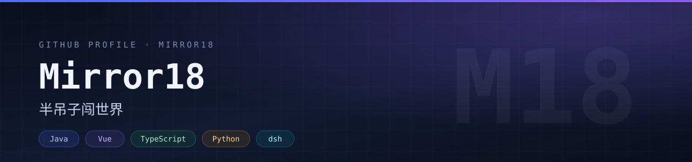

  

<h2 align="center">半吊子闯世界</h2>

  后端工程 / 微信小程序 / Agent 工具链 
  把折腾过的东西整理成能复跑、能恢复的材料。

  
  
  
  
  
  
  

### 🔭 最近在做

- **DeepSeek Harness（dsh）工具链**：本机实践档案、插件改造、MCP / LSP 接入、多 agent 编排，以及本地加密凭证金库 [dsh-bws](https://github.com/Mirror18/dsh-bws)。
- **微信小程序全栈**：「周末去哪」系列 —— 前端交互 + 云托管后端（`callContainer` + 标准 SQL），可迁到自有服务器。
- **内容创作知识库（KCS）**：DSH 内容类插件怎么实现、图文 / 视频 / 文本三条赛道的结论、平台如何选。

### 📌 精选项目

| 项目 | 一句话 | 技术栈 |
| :-- | :-- | :-- |
| **[dsh-bws](https://github.com/Mirror18/dsh-bws)** | 本地加密凭证金库（DSH 插件 + CLI）：SQLite + AES-256-GCM，口令派生密钥，git 多远端同步 | Node.js · SQLite |
| **[RAGForge](https://github.com/Mirror18/RAGForge)** | 知识库实践：文档入库、检索与问答的完整链路 | Java · Python · Vue |
| **[xiaohongshu_mirror](https://github.com/Mirror18/xiaohongshu_mirror)** | 仿小红书的微服务练习：服务拆分与接口联调 | Java · Lua |
| **[weblog_vue_springboot2](https://github.com/Mirror18/weblog_vue_springboot2)** | 前后端分离的博客系统 | Spring Boot · Vue |

### 📊 一点数据

  
  

### 🧭 一句话原则

> 状态只写一处，步骤可复跑，结论与证据分层。

  主页与仓库文档由 DeepSeek Harness 协助整理 
  

