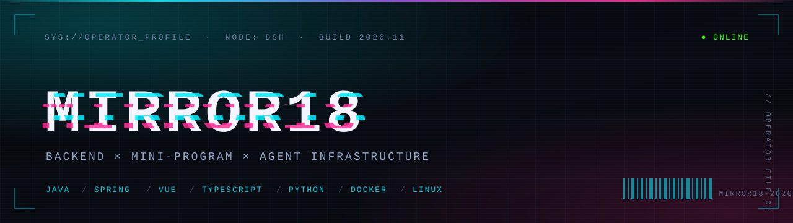

<div align="center">
  
</div>

<div align="center">
  
</div>

<p align="center">
  <a href="https://github.com/Mirror18?tab=repositories"></a>
  
  
</p>

<div align="center">
  
</div>

## `01 // OPERATOR`

> 复杂系统不会因为写得漂亮而可靠，只会因为能被复现而可靠。

| FIELD | VALUE |
| :-- | :-- |
| **CODENAME** | `MIRROR18` — 半吊子闯世界 |
| **ROLE** | 后端架构 · 全栈交付 · Agent 基础设施 |
| **STATE** | 在 DeepSeek Harness 上构建插件、MCP 网关与多 agent 编排 |
| **QUEUE** | 把本机实践沉淀成可迁移的文档资产；内容创作知识库（KCS）成体系 |
| **METHOD** | 状态只写一处 · 步骤可复跑 · 结论与证据分层 |
| **OUTPUT** | 能迁移、能复核、能交给下一个人继续跑的东西 |

## `02 // ARSENAL`

<p align="center">
  
  
  
  
  <br>
  
  
  
  
  <br>
  
  
  
  
  
  
</p>

## `03 // SYSTEM MAP`

```text
┌─ OPERATOR NODE ────────────────────────────────────────────────────┐
│                                                                    │
│   editor / cli ──▶ deepseek harness ──▶ plugins · mcp · agents     │
│                                                                    │
│   wechat mini-program ──▶ cloud run (callContainer) ──▶ sql        │
│                                                                    │
│   web client ──▶ spring boot api ──▶ mysql · redis                 │
│                                                                    │
└────────────────────────────────────────────────────────────────────┘
```

## `04 // MODULES`

| MODULE | CLASS | SPEC | STACK |
| :-- | :-- | :-- | :-- |
| **[DSH-BWS](https://github.com/Mirror18/dsh-bws)** | `VAULT` | 本地加密凭证金库：SQLite + AES-256-GCM，口令派生密钥，git 多远端同步 | Node.js · SQLite |
| **[RAGFORGE](https://github.com/Mirror18/RAGForge)** | `KNOWLEDGE` | 知识库实践：文档入库、检索与问答的完整链路 | Java · Python · Vue |
| **[XHS-MIRROR](https://github.com/Mirror18/xiaohongshu_mirror)** | `MICROSERVICE` | 仿小红书的微服务练习：服务拆分与接口联调 | Java · Lua |
| **[WEBLOG](https://github.com/Mirror18/weblog_vue_springboot2)** | `FULLSTACK` | 前后端分离的博客系统 | Spring Boot · Vue |

## `05 // TELEMETRY`

<p align="center">
  
  
</p>

<p align="center">
  
</p>

<p align="center">
  
</p>

## `06 // UPLINK`

<p align="center">
  <a href="https://github.com/Mirror18"></a>
  <a href="https://github.com/Mirror18/dsh-bws"></a>
  <a href="https://github.com/deepseek-ai/deepseek-harness"></a>
</p>

<div align="center">
  
</div>

<p align="center">
  <sub><code>// EOF — transmission complete · 2026</code></sub>
</p>
